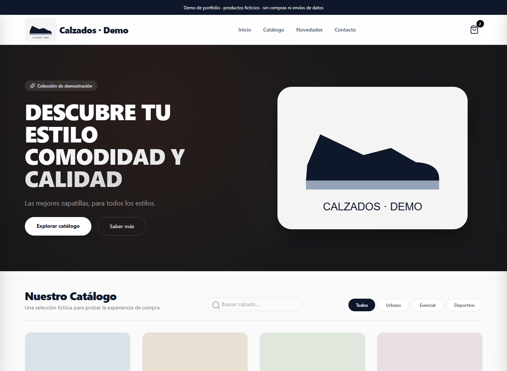

# Calzados · Demo de portfolio

Demostración de un escaparate de calzado con **JavaScript, HTML y CSS**: catálogo, búsqueda, filtros, selección de talla/color y carrito persistente. Derivada del proyecto WebPedroMorenoCalzados y adaptada para poder mostrar el código sin publicar la configuración ni los datos del negocio.

**Todos los productos, imágenes e importes de esta copia son ficticios. No es una tienda operativa: no crea pedidos, no procesa pagos y no envía formularios.**



## Ejecutar

Con Node.js 20 o posterior:

```sh
npm start
```

Abre **http://127.0.0.1:4173**. No es necesario instalar dependencias para ver la demo: CSS e iconos están incluidos localmente. Usa un servidor HTTP; abrir el HTML con doble clic no carga correctamente los módulos JavaScript.

## Funcionalidades

- Catálogo local con seis productos ficticios, búsqueda y filtros por categoría.
- Detalle del producto, miniaturas y selección de variantes; un ejemplo de talla agotada.
- Carrito con cantidades, eliminación y subtotal. Solo guarda IDs de ejemplo, variantes y cantidades en `localStorage`.
- Recuperación frente a datos de carrito corruptos o almacenamiento deshabilitado.
- Formulario con validación nativa: muestra un resultado local y descarta sus campos. No realiza envíos.
- Simulación de pedido sin transacciones.
- Navegación adaptable a móvil, controles de teclado y cierre de diálogos con Escape.

## Estructura

| Archivo | Responsabilidad |
| --- | --- |
| `index.html`, `styles.css` | Estructura y presentación derivadas del escaparate original |
| `app.js` | Interfaz y eventos mediante DOM seguro; sin HTML generado a partir de datos |
| `core.js` | Validación y persistencia del carrito, búsqueda y control de URLs de imagen |
| `demo-data.js` | Catálogo ficticio independiente del negocio |
| `shopify-api.js` | Adaptador GraphQL de ejemplo, aislado de la demo |
| `assets/` | Ilustraciones SVG de ejemplo, CSS compilado e iconos locales |
| `tests/` | Pruebas de carrito, integración simulada y límites de publicación |
| `scripts/serve.mjs` | Servidor de vista previa local con lista explícita de archivos servibles |

## Integración Shopify de ejemplo

`shopify-api.js` conserva una muestra de integración con **Storefront GraphQL**: mapea productos/variantes y construye un carrito con identificadores de variante y cantidades. Está **desconectado de la interfaz pública**. Las pruebas usan respuestas simuladas y no contactan Shopify.

`config.example.js` contiene únicamente marcadores ficticios. No hay una tienda conectada ni credenciales funcionales.

Para integrar una tienda propia hay que revisar permisos, moneda, inventario, paginación, variantes sin talla/color, dominios de checkout y cabeceras del despliegue. La política CSP de esta demo bloquea las conexiones externas deliberadamente. El adaptador no es una solución comercial lista para producción; limita el catálogo a la primera página solicitada y hasta 100 variantes por producto.

**Una configuración enviada al navegador es pública**, aunque el archivo esté en `.gitignore`. Solo un token Storefront expresamente público y con permisos mínimos puede usarse en frontend. Tokens Admin API, Storefront privados y otros secretos requieren un servidor.

## Pruebas y estilos

```sh
npm test
# Solo si vas a modificar las clases de Tailwind:
npm ci --ignore-scripts
npm run build:css
```

Los estilos se generan con Tailwind CSS 3.4.17 fijado en el archivo de dependencias. Lucide está incluido localmente con su licencia; consulta `THIRD_PARTY_NOTICES.md`.

## Qué se ha separado de la versión privada

- Configuración y conexiones reales de tienda y formulario.
- Identidad fiscal, direcciones y contactos del negocio.
- Archivo original de fotografías y sus metadatos; esta copia usa ilustraciones SVG de ejemplo.
- Historial Git anterior, configuraciones de editor y archivos locales.
- Carga de scripts, fuentes o imágenes desde proveedores externos al abrir la demo.

El formulario y el botón de pedido están identificados como simulaciones. No se hacen afirmaciones sobre pedidos reales ni ventas en producción.

## Publicar esta copia

Publica esta carpeta en un **repositorio nuevo**. No cambies a público el repositorio privado original: sus revisiones antiguas no se han saneado. La copia local de entrega tiene un historial nuevo sin remoto configurado.

Para una demo estática publica solo `index.html`, `app.js`, `core.js`, `demo-data.js`, `styles.css` y `assets/`. El servidor incluido es para vista previa local y escucha exclusivamente en `127.0.0.1`.

No añadas una licencia sobre fotografías, marcas o código de terceros que no puedas autorizar. La disponibilidad pública de este repositorio no concede automáticamente una licencia sobre el proyecto original.
